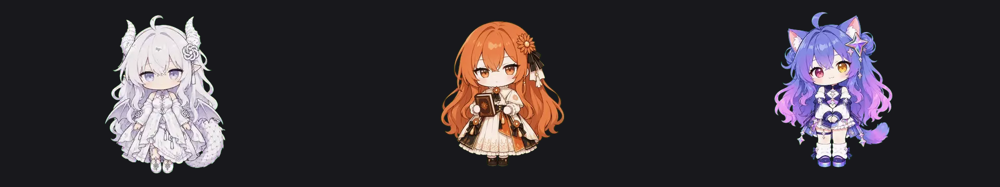

# dsh-ai-pets · DSH 桌宠素材包

给 [DeepSeek Harness](https://github.com/deepseek-harness) 的桌宠插件 `dsh-pet` 加三只 AI 桌宠：**GPT / Claude / Gemini**。



装上之后它们会在桌面右下角排排站：会待机呼吸、会左右张望、被拖起来会手脚乱蹬、点一下会回应你、干活的时候会自己去忙、钱包见底了会皱眉。右键还有一整棵三级菜单（动作 / 吃喝 / 玩耍 / 才艺 / 情绪 / 工作 …），每只 92–166 个动作。

> 大肥鱼（DSH 内置那只鲸鱼娘）不在这里——她是 `dsh-pet` 自带的。本包只管这三只外来的 AI。

---

## 它到底装了什么

```
<DSH_HOME>/dsh-pet/pet/
├── gpt-config.json        # 宠物种类定义：动画池 + 事件 + 位置
├── gpt-animation/         # 92 个透明 webm
├── claude-config.json
├── claude-animation/      # 166 个
├── gemini-config.json
└── gemini-animation/      # 100 个
```

`dsh-pet` 扫这个目录，看到 `*-config.json` 就注册一只新宠物，看到同前缀的 `*-animation/` 就取素材。
**前缀必须和文件名一致**——写错的话不会报错，只会安静地回落到内置素材（症状：名字是 GPT、动的却是大肥鱼）。

## 安装

```bash
# 1) 先有 dsh-pet（桌宠宿主），没有就先装
dsh plugin --profile web add dsh-pet

# 2) 再装本包
dsh plugin --profile web add dsh-ai-pets

# 3) 重启
dsh web    # 桌面版直接重开 App
```

第一次启动后，插件会用 100MB+ 的下载换三只宠物，日志里能看到进度：

```
[dsh-ai-pets] GPT 素材缺失，开始下载（约 126MB）：https://github.com/.../gpt.tar.gz
[dsh-ai-pets] GPT 下载中 42MB / 126MB (33%)
[dsh-ai-pets] GPT 安装完成（92 个动作）
...
[dsh-ai-pets] 全部处理完毕，重启 DSH 后桌面上就能看到
```

**素材不在 npm 包里**——单个宠物 100MB 上下，塞进包里既不现实也没必要。包内只有配置和下载逻辑，视频从 GitHub Release 拉。

## 配置

写在 profile 的 `cordis.patch.yml` 里覆盖默认值：

```yaml
- insert:
    - id: dsh-ai-pets
      name: dsh-ai-pets
      config:
        autoInstall: true        # false = 只写配置，素材自己手动放
        only: [gpt, gemini]      # 只装这几只，默认全装
        baseUrl: https://colormuse.github.io/...  # 自建镜像时改这里
```

或者手动放素材（国内网络拉 GitHub 经常卡）：

```bash
# 下载三只（或任意一只）后解压到宠物目录
tar -xzf gpt.tar.gz -C ~/.dsh/dsh-pet/pet/
```

## 位置调整

三只默认 `bottom-right`，`marginX` 40 / 220 / 400 排开。想换位置就改 `packs/*.json` 里的 `position`：

```json
"position": { "corner": "bottom-right", "marginX": 40, "marginY": 80 }
```

- `corner`：`top-left` / `top-right` / `bottom-left` / `bottom-right`
- `marginX` / `marginY`：离屏幕边的像素
- ⚠️ **`marginX` 别写负数**：`bottom-right` 的 x 是 `屏宽 - size - marginX`，负数会把窗口推出屏幕外（窗口在，只是看不见，容易以为没装上）

改完重启 DSH：桌面窗口列表是启动时建的，运行中改配置不会重新布局。

## 常见问题

**名字有了，动作还是大肥鱼的**
素材目录名和配置前缀对不上。检查 `pet/<prefix>-animation/` 是否存在、里面是否有 `.webm`。

**视频是黑底 / 不透明**
透明视频是 VP9 + `yuva420p` + `ALPHA_MODE=1` 元数据。`ffprobe` 里看不到 alpha 平面是正常的（显示 `yuv420p` 也不代表坏了），要用**支持 alpha 的 webm 解码**（Chromium / Electron 默认支持，Safari 不支持）。

**换了素材浏览器还是旧的**
素材路由带 `cache-control: max-age=3600`。改完素材要 `Cmd+Shift+R` 硬刷，或者重启。

**下载失败 / 一直卡住**
插件不会抛错也不会阻塞 DSH 启动，只在日志里说一声。可以手动下载 Release 里的 `*.tar.gz` 解压到 `<DSH_HOME>/dsh-pet/pet/`，效果一样。

## 素材从哪来 / 能不能商用

**能发内容，不能商用。** 详见 [NOTICE.md](NOTICE.md)：

- 素材原始作者：[PC2005-cloud/dsh-pet](https://github.com/PC2005-cloud/dsh-pet)（表情与动作原案）
- 整理与打包：[hunmer/aboutme-pets](https://github.com/hunmer/aboutme-pets)（精灵图 + 动作元数据 + 转换脚本）
- 本仓库做的是：精灵图 → 透明 webm、配置生成、插件化封装

上游明确要求：**素材禁止商用；二创在公开渠道须署名上游仓库**。所以拿去做视频、发抖音可以，接商单/带货/卖钱不行，并且要署名。

## 开发

```bash
# 本机素材（~/.dsh/dsh-pet/pet/）重新打 Release 包 + 算 sha256 写 catalog
node scripts/build-release.mjs --out dist \
  --base-url https://github.com/<owner>/dsh-ai-pets/releases/latest/download

# 冒烟测试：本地起个静态服指 dist，用假 DSH_HOME 跑一遍安装链路
python3 -m http.server 8791 --directory dist &
DSH_HOME=/tmp/aipets-home node test/apply-smoke.mjs '{"baseUrl":"http://127.0.0.1:8791","only":["gpt"]}'
```

发布：推 tag `v0.1.0` → GitHub Actions 自动打包三只 tar.gz 挂到 Release（见 `.github/workflows/release.yml`）。

## License

- 代码（`lib/` `packs/` `scripts/`）：MIT
- 素材（`dist/*.tar.gz` 里的 webm，以及 `packs/` 里的动画清单）：CC BY-NC-SA 4.0，署名见 NOTICE.md
